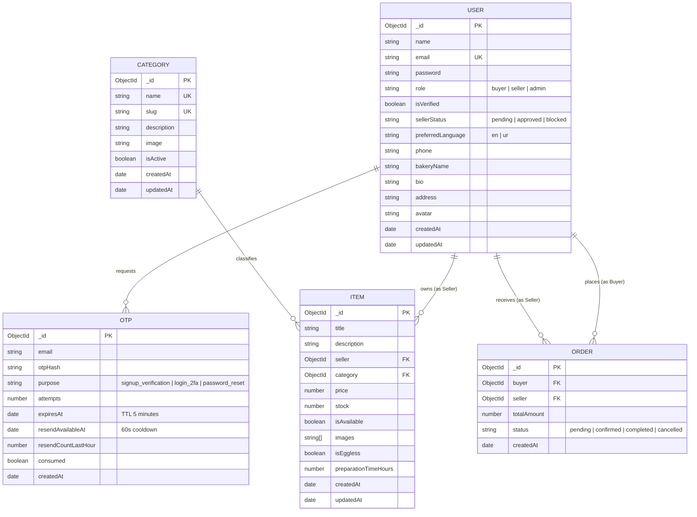

# MeethaCart — Database Schema Documentation

MeethaCart MongoDB database schema documentation for Final Year Project (FYP).
Built with **Mongoose (ODM)** for schema validation, strict types, indexing, and data integrity.

---

## 1. Entity Relationship Diagram (ERD)

---

## 2. Collections & Schema Details

### 2.1 User Collection (`users`)
Stores buyers, home bakers/sellers, and administrators.

| Field | Type | Required | Constraints / Default | Purpose / Defense Explanation |
|---|---|---|---|---|
| `_id` | ObjectId | Yes | Auto-generated PK | Unique user identifier |
| `name` | String | Yes | Trimmed, 2-60 chars | Display name of user / baker |
| `email` | String | Yes | Unique, lowercase, valid email | Primary authentication credential |
| `password` | String | Yes | Bcrypt hash (min 8 char plain) | Secure salt & hashed password (cost factor: 12) |
| `role` | String | Yes | Enum: `['buyer', 'seller', 'admin']`, default `'buyer'` | Role-based access control (RBAC) |
| `isVerified` | Boolean | Yes | Default: `false` | True only after 6-digit OTP verification |
| `sellerStatus` | String | Yes | Enum: `['pending', 'approved', 'blocked']`, default `'approved'` (for buyer/admin), default `'pending'` (for seller) | Admin approval gatekeeper before sellers can list items |
| `preferredLanguage`| String | Yes | Enum: `['en', 'ur']`, default `'en'` | Bilingual FYP requirement (stored for FYP-II NLLB translation) |
| `phone` | String | No | Trimmed | Contact number for order dispatch |
| `bakeryName` | String | Conditional | Trimmed (Required for Sellers) | Brand name for home bakery storefront |
| `bio` | String | No | Max 500 chars | Public bio shown on baker profile |
| `address` | String | No | Trimmed | Delivery address or bakery kitchen location |
| `avatar` | String | No | URL / path | Profile avatar image |
| `createdAt` | Date | Auto | Timestamps enabled | Audit trail for registration date |
| `updatedAt` | Date | Auto | Timestamps enabled | Last profile update timestamp |

---

### 2.2 OTP Collection (`otps`)
Manages high-security One-Time Passwords for registration verification, 2FA login, and password resets.

| Field | Type | Required | Constraints / Default | Security Rule / Defense Explanation |
|---|---|---|---|---|
| `_id` | ObjectId | Yes | Auto-generated PK | Unique OTP transaction ID |
| `email` | String | Yes | Indexed, lowercase | Target email for verification |
| `otpHash` | String | Yes | Bcrypt hash | **Never stored in plain text**; prevents DB leak exploits |
| `purpose` | String | Yes | Enum: `['signup_verification', 'login_2fa', 'password_reset']` | Context isolation; signup OTP cannot be used for login |
| `attempts` | Number | Yes | Default: `0`, max: `5` | Locks transaction after 5 failed brute-force attempts |
| `expiresAt` | Date | Yes | MongoDB TTL index (expires after 5 mins) | Automatic database cleanup & time-limited validity |
| `resendAvailableAt`| Date | Yes | Current time + 60s | Enforces 60-second cooldown between resend requests |
| `resendCountLastHour`| Number | Yes | Default: `1`, max: `5` per hour | Defense against spamming mail servers |
| `consumed` | Boolean | Yes | Default: `false` | Prevents replay attacks (single-use only) |

---

### 2.3 Category Collection (`categories`)
Bakery categories managed exclusively by Admin (e.g., Cakes, Biscuits, Mithai).

| Field | Type | Required | Constraints / Default | Purpose / Defense Explanation |
|---|---|---|---|---|
| `_id` | ObjectId | Yes | Auto-generated PK | Unique category identifier |
| `name` | String | Yes | Unique, trimmed, 2-50 chars | Display name (e.g., "Custom Cakes", "Traditional Mithai") |
| `slug` | String | Yes | Unique, lowercase, kebab-case | SEO-friendly URL slug |
| `description` | String | No | Max 300 chars | Category summary |
| `image` | String | No | URL / path | Thumbnail representation |
| `isActive` | Boolean | Yes | Default: `true` | Allows admin to soft-hide categories without breaking item refs |

---

### 2.4 Item Collection (`items`)
Bakery products listed by approved sellers.

| Field | Type | Required | Constraints / Default | Purpose / Defense Explanation |
|---|---|---|---|---|
| `_id` | ObjectId | Yes | Auto-generated PK | Unique item identifier |
| `title` | String | Yes | Trimmed, 3-100 chars | Item title (e.g. "Belgian Chocolate Fudge Cake") |
| `description` | String | Yes | Trimmed, 10-1000 chars | Detailed ingredients, taste notes, allergens |
| `seller` | ObjectId | Yes | Ref: `'User'`, Indexed | Foreign key linking to the approved home baker |
| `category` | ObjectId | Yes | Ref: `'Category'`, Indexed | Category classification |
| `price` | Number | Yes | Min: `1` PKR | Validated on server; client price is never trusted |
| `stock` | Number | Yes | Default: `0`, Min: `0` | Available quantity |
| `isAvailable` | Boolean | Yes | Default: `true` | Seller toggle to pause orders when busy |
| `images` | [String] | Yes | Array of 1-5 image URLs/paths | Uploaded bakery item photos |
| `isEggless` | Boolean | Yes | Default: `false` | Dietary indicator |
| `preparationTimeHours` | Number | Yes | Default: `24`, Min: `1` | Hours required to bake fresh |
| `createdAt` | Date | Auto | Timestamps enabled | Sorting by newest items |

---

### 2.5 Order Collection (`orders`) — *Placeholder for M2/Future*
Minimal schema enabling Admin empty state view and structural readiness for M4.

| Field | Type | Required | Notes |
|---|---|---|---|
| `_id` | ObjectId | Yes | Order ID |
| `buyer` | ObjectId | Yes | Ref: `'User'` |
| `seller` | ObjectId | Yes | Ref: `'User'` |
| `totalAmount` | Number | Yes | PKR sum |
| `status` | String | Yes | `['pending', 'confirmed', 'completed', 'cancelled']` |
| `createdAt` | Date | Auto | Timestamp |
